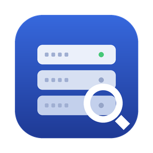
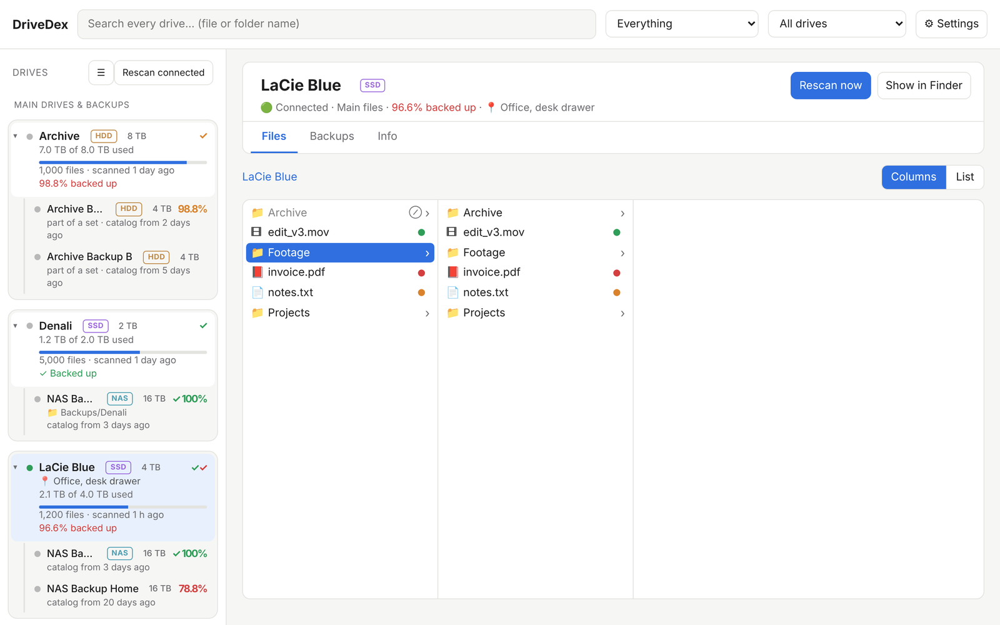
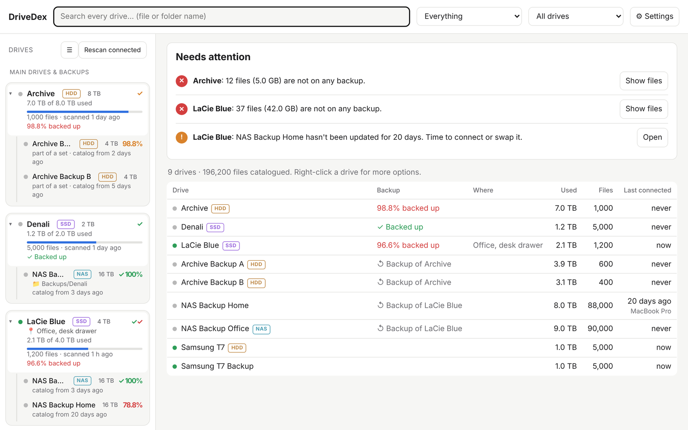
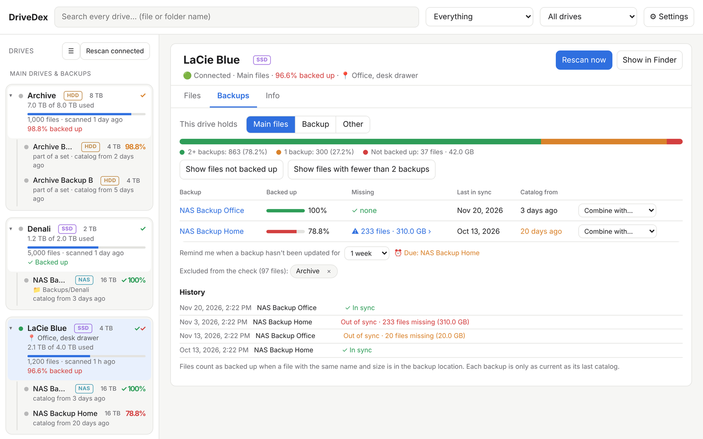
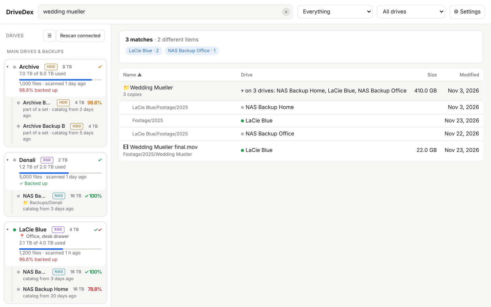

  

<h1 align="center">DriveDex</h1>

  <b>Know what's on every drive, even the ones in a drawer, and whether it's backed up.</b> 
  A small, free Mac app for people who juggle external drives, SSDs and NAS shares.

  <a href="https://github.com/marcialsommer/drivedex/releases/latest/download/DriveDex.dmg"><b>⬇︎ Download DriveDex for Mac</b></a>
  &nbsp;·&nbsp;
  <a href="docs/DriveDex-Guide.pdf"><b>📖 User guide (PDF)</b></a>
  &nbsp;·&nbsp;
  <a href="https://github.com/marcialsommer/drivedex/releases/latest">Release notes</a>

  

## What it does

- **Catalogs every drive automatically.** Plug in a drive or connect a NAS share and DriveDex records what's on it: file and folder names, sizes and dates. It never reads file contents. Known drives are updated whenever you connect them.
- **Browse and search drives that aren't connected.** Finder-style icon, list and column views with back and forward buttons, and search across all your drives at once. Identical files show as one result ("on 3 drives"), and you can filter by videos, photos, projects and more.
- **Shows whether everything is backed up.** Mark which drives hold your originals and where their backups are: whole drives, a folder on a NAS, or a backup split over several drives. DriveDex checks file by file and shows what's on 2+ backups, on 1, or on none, with the exact list of what's missing. Changed a link by mistake? Every change can be undone.
- **Tells you when something needs attention.** A "Needs attention" home screen; mark items as done when they're fine as they are, and they come back only if something changes. There's also an optional reminder when a backup drive hasn't been connected for a while, handy if you swap backups between home and the office.
- **Shoot mode for productions.** Plug in memory cards and see, card by card, whether everything is on your main drive and on every backup, and when a card is safe to format. An optional deep check compares the actual contents.
- **Remembers where drives live.** A location note ("office, top drawer") and which Mac last saw each drive, shown in the drive list and in search results.
- **Works across your Macs.** Share the catalog through iCloud Drive, Google Drive or Dropbox, so every Mac sees every drive.
- **Updates itself.** One click installs new versions.

<table>
  <tr>
    <td width="50%"> <b>Needs attention:</b> files without a backup, incomplete or overdue backups.</td>
    <td width="50%"> <b>Backup status per drive:</b> each backup's completeness, last time in sync, history.</td>
  </tr>
  <tr>
    <td colspan="2"> <b>Search every drive at once</b>, including disconnected ones, with copies grouped together.</td>
  </tr>
</table>

Screenshots use example drives.

## Install

1. [Download **DriveDex.dmg**](https://github.com/marcialsommer/drivedex/releases/latest/download/DriveDex.dmg), open it and drag **DriveDex** into **Applications**.
2. Open DriveDex. macOS will say it can't verify the app. Click **Done** (not Move to Trash).
3. Open **System Settings → Privacy & Security**, scroll down and click **Open Anyway** next to DriveDex.
4. When asked, allow access to removable and network volumes.

You only do steps 2–3 once. DriveDex isn't signed with a paid Apple developer certificate, which is why macOS asks. Updates installed from inside the app don't need it again.

Requires **macOS 13 Ventura or newer** (Apple Silicon or Intel). The [user guide](docs/DriveDex-Guide.pdf) explains everything step by step.

## How it works, and what it doesn't do

**DriveDex reads each drive's table of contents, never the files themselves.** Every drive keeps an index of what's on it: for each file its name, size and dates. DriveDex asks macOS for that index, folder by folder, and saves it. That's why scanning is fast (seconds to minutes, even for many terabytes) and why it works on drives that aren't connected: it's looking at its saved copy.

**How the backup check decides a file is backed up:** a backup drive (or backup folder) has a file with the **same name and the same size**, in any folder. With *Strict backup check* in Settings the modification date must match too. This is fast and catches what usually goes wrong (files never copied, a copy that stopped halfway, a forgotten folder), but it has limits:

- **It doesn't read file contents.** A copy that is damaged but still the same size counts as backed up. DriveDex can't tell you a file will open.
- **A renamed file counts as missing**, because names are compared.
- **It's a snapshot.** A drive's catalog is only as current as its last scan. A backup that hasn't been connected for a while may have changed (or failed) since. DriveDex shows how old each catalog is.
- Hidden files are skipped unless you turn them on, and app/library bundles (for example Final Cut libraries) count as one item.

Shoot mode uses the same rule: a memory card is "safe to format" when every file on it is in the main folder and every backup folder with the same name and size. For certainty, Shoot mode also has a **Deep check**: it reads every file on the card and each copy and compares their contents (xxHash64 fingerprints). It only reads, never writes, and takes about as long as copying the card. Once a card is safe, Shoot mode can also **format it and keep its name** ("CHRIS SD1" stays "CHRIS SD1"), or just rename it, but only when you click it.

**DriveDex doesn't copy, back up or repair anything.** It never writes to your drives, with one exception you trigger yourself: formatting or renaming a memory card in Shoot mode. For the copying itself, use a dedicated tool:

- **Backups of drives and folders:** [Carbon Copy Cloner](https://bombich.com) (reliable for years, with scheduled and incremental backups), ChronoSync, or Time Machine.
- **Memory cards on a shoot:** an offload tool that compares checksums (a fingerprint of each file's actual contents), such as Hedge OffShoot, ShotPut Pro or Pomfort Silverstack.

Then let DriveDex keep the overview: what's on which drive, and whether anything has been missed.

## Privacy

- DriveDex only stores **names, sizes and dates** of files and folders. It never opens or uploads your files.
- The catalog stays **on your Mac**. If you turn on sharing between Macs, it's also stored in **your own** iCloud Drive or sync folder.
- Nothing is sent to anyone else. The only network requests are to GitHub, to check for and download updates.
- DriveDex never changes anything on your drives. The only exception: in Shoot mode you can format or rename a memory card, after it's confirmed safe, with a final confirmation.

## Feedback

Found a problem or have an idea? Use **Settings → Feedback** in the app, or [open an issue](https://github.com/marcialsommer/drivedex/issues/new). Issues are public, so please leave out private file names.

DriveDex is a personal project, provided as is. It's a great help for finding things and spotting gaps in your backups, but don't make it your only check.

---

<b>For developers</b>

Plain Swift with no dependencies: an AppKit shell with a WKWebView interface and a SQLite catalog.

| Path | What |
|---|---|
| `Sources/main.swift` | App, window, menus, menu-bar icon |
| `Sources/Scanner.swift` | Drive detection, scanning, reminders |
| `Sources/Catalog.swift` | SQLite catalog, search, backup coverage |
| `Sources/Sync.swift` | Sharing the catalog between Macs |
| `Sources/Updater.swift` | In-app updates from GitHub releases |
| `Sources/Bridge.swift` | Actions the interface calls |
| `Resources/index.html` | The interface |

Every push to `main` is built by GitHub Actions (`.github/workflows/build.yml` → `build.sh`) and published as the `latest` release (`DriveDex.dmg` plus `DriveDex.zip` for the updater). To build locally on a Mac with the Xcode command line tools: `./build.sh`.

